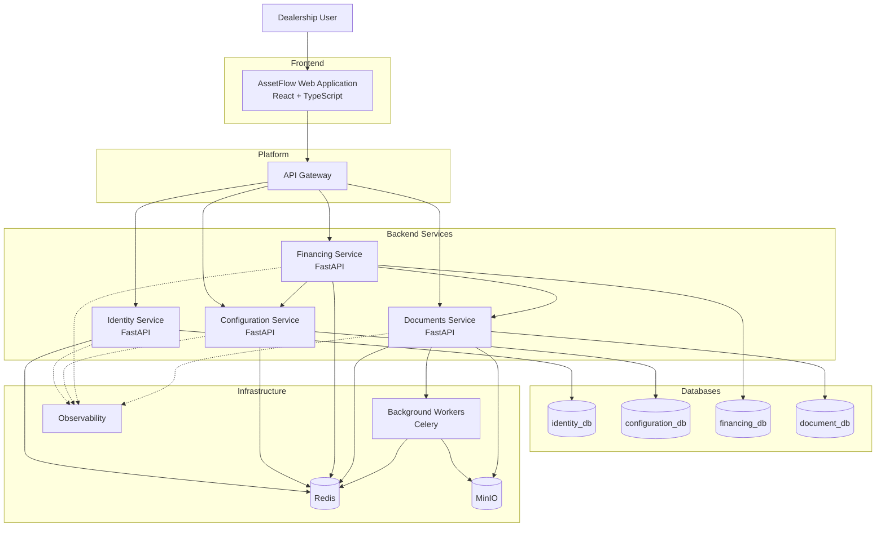
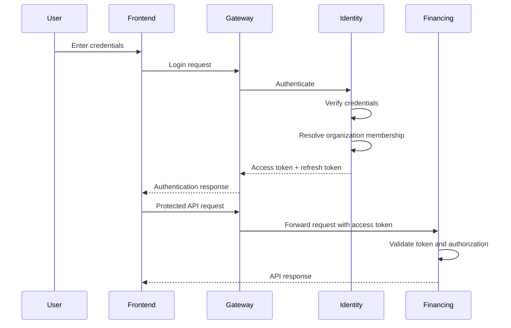
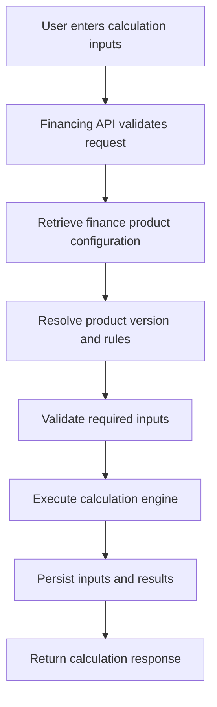
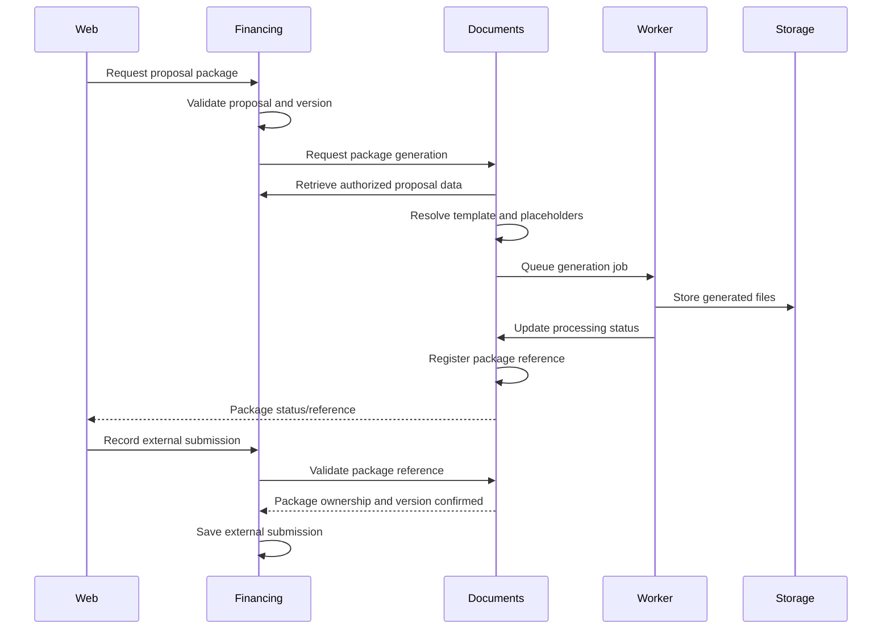

# 05 — System Architecture

## 1. Purpose

This document defines the technical architecture of AssetFlow, including:

- System components and their responsibilities.
- Repository and service boundaries.
- Communication between services.
- Database ownership and data flow.
- Authentication, authorization, and tenant isolation.
- Synchronous and asynchronous processing.
- Document storage and generation.
- Local development and eventual production deployment.
- Architectural principles and constraints.

This document complements:

- `00_PROJECT_CHARTER.md`
- `01_PRD.md`
- `02_BUSINESS_WORKFLOWS.md`
- `03_DOMAIN_MODEL.md`
- `04_DATABASE_DESIGN.md`

If an implementation decision conflicts with an approved business or database requirement, the relevant specification takes precedence.

---

## 2. Architecture Overview

AssetFlow follows a **service-oriented architecture with independently owned databases**.

The platform consists of:

- One React frontend.
- Four backend services.
- One API gateway.
- One shared contracts repository.
- One platform/infrastructure repository.
- Supporting infrastructure for caching, background processing, file storage, and observability.

Each backend service owns its business logic, database, migrations, and internal data access.

The services communicate through documented APIs and asynchronous events. They must not directly access another service's database.

### 2.1 High-level architecture



The diagram represents logical ownership and communication. It does not mean every request must pass through every service.

---

## 3. Repository Architecture

AssetFlow is maintained through six repositories.

| Repository | Responsibility |
|---|---|
| `AssetFlow-platform` | Docker Compose, API gateway, infrastructure, monitoring, CI/CD, deployment configuration |
| `AssetFlow-identity` | Authentication, users, organizations, memberships, roles, permissions, and security |
| `AssetFlow-configuration` | Organization configuration, finance products, product rules, asset definitions, and settings |
| `AssetFlow-financing` | Customers, assets, lenders, calculations, quotations, proposals, and external submission records |
| `AssetFlow-document` | Document storage, templates, generation, conversion, processing, and package references |
| `AssetFlow-web` | The single React application containing all user-facing modules |

### 3.1 Repository independence

Each backend repository must be independently understandable and maintainable.

A backend repository owns:

- Its application code.
- Its API endpoints.
- Its database models.
- Its database migrations.
- Its service-level tests.
- Its configuration and environment variables.
- Its internal business logic.

Services must not import another service's internal database models or application modules.

### 3.2 Shared contracts

- Each FastAPI service owns its Pydantic request and response models.
- FastAPI generates the OpenAPI specification from these models.
- OpenAPI specifications serve as the API contracts for frontend and service integrations.
- The frontend generates TypeScript types and API clients from the service specifications where practical.
- Shared error response conventions are documented and implemented consistently across services.
- Event schemas are versioned and maintained alongside the service that owns and publishes the events.
- Services must not duplicate another service's internal models or import its implementation code.

---

## 4. Backend Service Responsibilities

### 4.1 Identity Service

Repository: `AssetFlow-identity`

Database: `identity_db`

The Identity Service is responsible for authentication, identity management, organization membership, and authorization.

Responsibilities:

- User registration and account management.
- Email verification.
- Login and logout.
- Password hashing and verification.
- Access-token issuance and validation support.
- Refresh-token management.
- Password reset.
- OTP challenges.
- Multi-factor authentication.
- User sessions.
- API key management.
- Organization creation and management.
- Organization membership.
- Organization-specific roles.
- Permissions and role-permission assignments.
- Member-role assignments.
- Login attempts and security audit records.

The service owns the following authorization relationships:

```text
User
  |
  | belongs to
  v
Organization Member
  |
  | assigned
  v
Role
  |
  | grants
  v
Permissions
```

A user may belong to multiple organizations and have different roles in each organization.

The active organization context must be established during authentication or organization switching.

The service does not own customer, asset, quotation, proposal, or document business records.

### 4.2 Configuration Service

Repository: `AssetFlow-configuration`

Database: `configuration_db`

The Configuration Service manages configurable platform and organization-level settings.

Responsibilities:

- Organization profiles and branding.
- Organization settings.
- Finance product catalog.
- Finance product versions.
- Product-specific rules and configurations.
- Organization-enabled finance products.
- Asset categories.
- Asset field definitions.
- Document template assignments.
- Notification settings.
- Integration settings.
- Configuration audit records.

#### Finance product catalog

The platform has one finance product catalog.

Initial entries:

- Hire Purchase (HP).
- Finance Lease.
- Operating Lease.

These are finance products within AssetFlow, not separate software products or repositories.

The Configuration Service controls product definitions and versions.

The Financing Service uses the relevant product configuration when performing calculations and creating quotations or proposals.

A transaction must retain a reference to the exact product configuration version used, so subsequent configuration changes do not silently change historical calculations.

The initial working product is HP. Finance Lease and Operating Lease are introduced in their respective releases.

### 4.3 Financing Service

Repository: `AssetFlow-financing`

Database: `financing_db`

The Financing Service owns the core dealership financing domain.

Responsibilities:

- Customer management.
- Customer addresses.
- Customer bank accounts.
- Vehicle and asset management.
- Lender records.
- Dealership-lender relationships.
- Lender-supported finance products.
- Financial calculations.
- Calculation history and versions.
- Quotations and quotation versions.
- Proposal and proposal versions.
- Applicants and co-applicants.
- Proposal contacts.
- External submission records.
- Business audit history.
- Financing-related reporting.

The service is responsible for applying finance rules and maintaining transaction consistency.

#### Finance calculation boundary

The Financing Service owns the calculation engine.

It obtains applicable product definitions and rule configurations from the Configuration Service.

The calculation engine must be designed so that product-specific rules can be extended without spreading product-specific assumptions across unrelated application modules.

Calculation inputs and outputs must be persisted using the relational structures defined in `04_DATABASE_DESIGN.md`.

Historical calculations must remain reproducible and traceable to the configuration and calculation versions used.

#### External lender boundary

The Financing Service does not implement lender-side processing.

For Release 1, it records dealership-side activity, including:

- Selected lender.
- Proposal version submitted.
- Registered proposal package reference.
- Submission timestamp.
- Submitting organization member.
- Optional lender reference.

The lender's actual underwriting, credit checks, decision, agreement generation, and servicing happen outside AssetFlow.

### 4.4 Documents Service

Repository: `AssetFlow-document`

Database: `document_db`

The Documents Service owns document storage and document-processing functionality.

Responsibilities:

- Document uploads.
- Document metadata.
- Document versions.
- Organization-scoped document access.
- Document templates.
- Template versions.
- Template assignments and generation support.
- Placeholder processing.
- PDF and DOCX generation.
- File conversion.
- Document verification.
- Background document-processing jobs.
- Proposal package references.
- Document access logs.

The service must enforce organization-level ownership and access restrictions.

A dealership must only access its own documents unless a specifically authorized workflow permits otherwise.

#### Document storage

Local development uses MinIO.

The production storage implementation is expected to use AWS S3.

The database stores document metadata and storage references, not file contents.

File access must be mediated by the Documents Service. Where presigned URLs are used, they must be short-lived and scoped to the required operation.

#### Proposal package references

A generated proposal package is registered in the Documents Service.

The package reference identifies the package and the exact proposal version it represents.

The Financing Service stores the package reference ID when recording an external submission.

Because the services have separate databases, this relationship is validated through service APIs rather than a cross-database foreign key.

---

## 5. Frontend Architecture

Repository: `AssetFlow-web`

Technology: React and TypeScript.

AssetFlow uses one frontend application for all dealership-facing functionality.

The frontend is organized into functional modules rather than separate applications.

Expected modules include:

- Authentication.
- Dashboard.
- Organization settings.
- User and role management.
- Finance product configuration.
- Customers.
- Vehicles and assets.
- Lenders.
- Calculations.
- Quotations.
- Proposals.
- Document management.
- Reporting.
- Audit history.

### 5.1 Frontend principles

- One application and one authentication experience.
- Shared layout, navigation, and reusable components.
- Feature-based module organization.
- Centralized API client configuration.
- Consistent request and error handling.
- Route-level authorization checks for user experience.
- Backend authorization remains mandatory.
- Form validation on the frontend and backend.
- No direct database access.
- No business-critical financial calculations trusted solely to the frontend.

### 5.2 Suggested frontend organization

```text
src/
├── app/
│   ├── router/
│   ├── providers/
│   └── layouts/
├── features/
│   ├── authentication/
│   ├── dashboard/
│   ├── organization/
│   ├── users/
│   ├── configuration/
│   ├── customers/
│   ├── assets/
│   ├── lenders/
│   ├── calculations/
│   ├── quotations/
│   ├── proposals/
│   ├── documents/
│   └── reporting/
├── components/
│   ├── common/
│   └── forms/
├── services/
│   ├── api/
│   └── auth/
├── hooks/
├── types/
├── utils/
└── main.tsx
```

This is a logical organization. Exact folder structures can be refined during frontend implementation without changing service boundaries.

---

## 6. API Gateway

The API Gateway is part of `AssetFlow-platform`.

The frontend communicates with backend services through a single entry point.

Example local routing:

```text
/api/identity/*       -> Identity Service
/api/configuration/*  -> Configuration Service
/api/financing/*      -> Financing Service
/api/documents/*      -> Documents Service
```

### 6.1 Gateway responsibilities

- Route requests to the appropriate backend service.
- Handle cross-origin configuration where required.
- Apply request-size and basic rate limits.
- Forward request IDs and tracing headers.
- Provide a consistent external API entry point.
- Expose health-check endpoints where appropriate.

The gateway must remain lightweight.

It must not become a second implementation of business logic, finance calculations, or service-owned authorization rules.

### 6.2 API composition

Some frontend screens require information owned by multiple services.

For example, a proposal detail screen may need:

- Proposal information from Financing.
- Finance product information from Configuration.
- Document package information from Documents.

The application should retrieve this information through the relevant service APIs.

An API composition layer may be introduced when a screen repeatedly requires aggregation.

However:

- Do not create synchronous calls to every service for every request.
- Do not duplicate service-owned business logic in the gateway.
- Do not expose database access across service boundaries.
- Use caching for suitable reference data.
- Use asynchronous events where real-time synchronous retrieval is unnecessary.

---

## 7. Database and Data Ownership

AssetFlow uses four independent PostgreSQL databases.

| Database | Owner | Main data |
|---|---|---|
| `identity_db` | Identity Service | Users, organizations, memberships, roles, permissions, authentication |
| `configuration_db` | Configuration Service | Finance products, product versions, organization settings, rules |
| `financing_db` | Financing Service | Customers, assets, lenders, calculations, quotations, proposals |
| `document_db` | Documents Service | Documents, templates, generated files, package references |

All four databases may run on the same local PostgreSQL server during development.

They remain logically and operationally separate databases.

### 7.1 Database ownership rules

1. Each service owns its database.
2. Only the owning service may read or write its database.
3. No cross-service database queries.
4. No cross-database foreign keys.
5. No shared SQLAlchemy models between services.
6. Cross-service relationships use identifiers and service APIs.
7. Database migrations are maintained by the owning repository.

### 7.2 Cross-service references

A record may contain an ID belonging to another service.

For example:

- Financing records contain organization IDs from Identity.
- Financing records contain finance product and product-version IDs from Configuration.
- Financing external submissions contain proposal package reference IDs from Documents.
- Organization profiles may contain document IDs from Documents.

These are logical references.

The owning service must validate external references through the appropriate service API when creating or updating records.

### 7.3 Historical consistency

Business transactions must preserve the configuration and input values that were used when they were created or submitted.

For example, a proposal must not change its historical financial values simply because:

- A finance product configuration changes.
- A customer updates their address.
- A vehicle record is corrected.
- A lender relationship is modified.

Use transaction versions and snapshots as defined in the domain and database specifications.

---

## 8. Inter-Service Communication

Services communicate through two mechanisms:

1. Synchronous HTTP APIs.
2. Asynchronous events and background jobs.

Use the simplest communication mechanism that satisfies the workflow.

### 8.1 Synchronous communication

Use HTTP APIs when the caller needs an immediate response.

Examples:

| Caller | Target | Purpose |
|---|---|---|
| Frontend | Identity | Login, account and membership operations |
| Frontend | Configuration | Retrieve settings and finance products |
| Frontend | Financing | Customer, asset, calculation, quotation and proposal operations |
| Frontend | Documents | Uploads and document retrieval |
| Financing | Configuration | Retrieve product definitions and rules |
| Financing | Documents | Validate and retrieve proposal package references |
| Documents | Financing | Retrieve authorized proposal data when required for package generation |

Service APIs must use versioned contracts and consistent error responses.

Internal service calls must authenticate the calling service and authorize the requested operation.

### 8.2 Asynchronous communication

Use background processing for operations that should not block an HTTP request.

Examples:

- PDF conversion.
- DOCX processing.
- Large document generation.
- OCR or document extraction if introduced.
- Email notifications.
- Other long-running document-processing tasks.

Redis and Celery are the initial local implementation.

A task must support:

- Retry policies.
- Failure handling.
- Idempotency where duplicate execution is possible.
- Processing status.
- Logging and traceability.

### 8.3 Event-driven integration

Events may be introduced for communication that does not require an immediate response.

Examples:

```text
organization.created
organization.member_added
finance_product.updated
quotation.created
proposal.version_created
proposal.package_generated
proposal.submitted_externally
document.processing_completed
```

Events must have versioned schemas maintained by their owning service, with backward compatibility managed explicitly.

The platform should use an outbox pattern for important events that must not be lost between a database transaction and event publication.

Event consumers must be idempotent.

Events are not a replacement for APIs when the caller needs an immediate answer.

---

## 9. Authentication and Authorization

Identity and authorization are owned by the Identity Service.

### 9.1 Authentication flow



The diagram is illustrative; refresh-token delivery and storage must follow the security requirements in `09_ENGINEERING_STANDARDS.md`.

### 9.2 Access tokens

Use short-lived signed access tokens.

Tokens should contain the minimum claims required to identify the authenticated context, such as:

- User ID.
- Active organization ID.
- Organization membership ID.
- Issuer.
- Audience.
- Expiration.
- Issued-at timestamp.
- Relevant authorization claims where appropriate.

Backend services must validate:

- Token signature.
- Issuer.
- Audience.
- Expiration.
- Required organization context.
- Required permissions.

Services must not trust an organization ID supplied only through a request body or query parameter.

### 9.3 Refresh tokens

Refresh tokens must be securely stored and managed by the Identity Service.

Support:

- Token rotation.
- Revocation.
- Expiration.
- Session invalidation.
- Reuse detection where appropriate.

Store refresh-token hashes rather than reusable plaintext secrets.

### 9.4 Role-based access control

Roles and permissions are stored in `identity_db`.

An organization member receives one or more organization-specific roles.

Roles grant permissions.

Example:

```text
Organization
    |
    v
Organization Member
    |
    v
Assigned Roles
    |
    v
Role Permissions
```

Services enforce permissions for their own operations.

Frontend route restrictions improve the user experience but never replace backend authorization.

Authorization changes must take effect within a defined token-validity and refresh policy. The implementation must not allow revoked permissions to remain effective indefinitely through stale token claims.

### 9.5 API keys

API keys are for authorized machine-to-machine or integration access.

- Show the secret only when created.
- Store only its secure hash.
- Support scopes, expiration, and revocation.
- Associate keys with an organization.
- Record last-used information.
- Never use an unrestricted shared master key for normal service communication.

---

## 10. Multi-Tenant Isolation

AssetFlow is a multi-tenant application.

Each dealership is an organization.

The same application and backend services serve multiple organizations, but their business data must remain isolated.

### 10.1 Tenant identification

Every authenticated business request must operate within a validated organization context.

The backend derives the organization context from the authenticated identity and membership.

### 10.2 Data isolation

Organization-owned records must include an organization reference where appropriate.

Examples:

- Customers.
- Assets.
- Lender relationships.
- Calculations.
- Quotations.
- Proposals.
- Documents.
- Organization-specific configuration.

Queries must always enforce organization scope.

A user must not access another dealership's records by changing a URL, record ID, request body, or query parameter.

### 10.3 Cross-service tenant validation

When one service references a record owned by another service, the reference must be validated against the correct organization.

For example, a proposal package must belong to the same organization and proposal version as the external submission that references it.

Tenant isolation is enforced by backend services, not just by frontend filtering.

---

## 11. Financial Calculation Architecture

The Financing Service owns the calculation engine.

The calculation engine must support multiple finance products without requiring a separate calculation implementation for every future product.

### 11.1 Calculation flow



### 11.2 Calculation principles

- Use decimal arithmetic for financial values.
- Never use binary floating-point arithmetic for money calculations.
- Separate product-specific rules from shared calculation infrastructure.
- Validate inputs before calculations.
- Keep calculation logic independent from HTTP controllers.
- Persist calculation inputs and outputs.
- Record the applicable product configuration version.
- Preserve historical calculation results.
- Add automated tests for calculation rules and edge cases.

### 11.3 Product extensibility

The initial implementation focuses on Hire Purchase.

The architecture must allow Finance Lease and Operating Lease to be introduced as additional product implementations.

A new product should be introduced through:

- Product definition and version.
- Product-specific input requirements.
- Product-specific calculation rules.
- Product-specific validation.
- Product-specific quotation and proposal requirements where applicable.

The platform must not assume every finance product uses identical financial fields or calculation formulas.

---

## 12. Document Generation Architecture

Document generation is owned by the Documents Service.

The Financing Service owns the financial and proposal data. The Documents Service owns templates, files, processing, and generated package records.

### 12.1 Proposal package flow



The exact API sequence may be refined during implementation, but ownership must remain unchanged.

### 12.2 Package requirements

A generated package must be traceable to:

- Organization.
- Proposal.
- Exact proposal version.
- Template version.
- Generated document versions.
- Generation timestamp.
- Processing status.

The package reference must identify the exact package used for an external submission.

Downloading a package does not constitute an external submission.

Only an explicitly recorded dealership action creates an external submission record.

### 12.3 Processing failures

Document-processing jobs must have:

- A unique job ID.
- Processing status.
- Retry count.
- Error details.
- Creation and completion timestamps.
- Relevant organization and document references.

A failed job must not silently appear as a successfully generated package.

---

## 13. Caching and Background Processing

### 13.1 Redis

Redis is used for supporting infrastructure such as:

- Celery broker and result backend.
- Short-lived caching.
- Temporary processing state where appropriate.
- Rate-limiting support.

Redis must not become the primary store for business records.

### 13.2 Caching policy

Suitable candidates include:

- Finance product definitions.
- Product configuration versions.
- Organization settings.
- Other relatively stable reference data.

Cache entries must have appropriate expiration and invalidation behavior.

Financial transaction records and authorization decisions must not rely on indefinitely stale cache entries.

### 13.3 Celery workers

Background workers initially handle document-processing tasks and other operations that do not require immediate API responses.

Workers must be independently deployable and observable.

---

## 14. Error Handling and Reliability

All services must follow consistent error-handling conventions.

### 14.1 API errors

All services must follow the common API error response format documented in their engineering standards and implemented through service-owned response models.

### 14.2 Timeouts and retries

Inter-service HTTP calls must have explicit timeouts.

Retries should be limited to appropriate transient failures.

Do not blindly retry operations that can create duplicate financial records.

Operations that may be retried must use idempotency controls where necessary.

### 14.3 Service availability

A failure in an unrelated service should not unnecessarily disable the entire platform.

For example, a customer-management request should not require the Documents Service to be available unless the operation actually needs document functionality.

Use health checks and meaningful service dependency handling.

---

## 15. Observability

Observability is part of the platform from the beginning, not a final cosmetic addition.

The initial stack includes:

- Structured application logs.
- Prometheus metrics.
- Grafana dashboards.
- OpenTelemetry tracing.
- Sentry error reporting.

### 15.1 Logging

Each service must produce structured logs.

Logs should include:

- Timestamp.
- Service name.
- Log level.
- Request ID.
- Trace ID where available.
- Organization context where appropriate.
- User or actor ID where appropriate.
- Operation or endpoint.
- Error details when applicable.

Never log passwords, access tokens, API key secrets, or sensitive financial and personal information unnecessarily.

### 15.2 Metrics

Track relevant metrics, including:

- Request count.
- Request latency.
- Error rate.
- Database connection health.
- Background-job success and failure.
- Queue depth.
- Document-processing duration.
- Resource utilization.

### 15.3 Tracing

Distributed traces should make it possible to follow a request across the API Gateway and multiple services.

Propagate correlation and trace identifiers through synchronous calls and background jobs where practical.

---

## 16. Local Development Architecture

Development and testing remain local until the platform is ready for its final deployment milestone.

Docker Compose is the primary local orchestration mechanism.

### 16.1 Local infrastructure

The local environment includes:

| Component | Purpose |
|---|---|
| PostgreSQL | Hosts the four independent databases |
| Redis | Cache and Celery broker |
| MinIO | S3-compatible object storage |
| API Gateway | Single backend entry point |
| Identity Service | Authentication and authorization |
| Configuration Service | Organization and finance product configuration |
| Financing Service | Core financing operations |
| Documents Service | Document management and generation |
| Celery Worker | Background processing |
| React Frontend | User interface |
| Prometheus | Metrics collection |
| Grafana | Monitoring dashboards |
| Sentry | Error tracking, using a suitable local or development configuration |
| OpenTelemetry | Distributed tracing |

### 16.2 Local database arrangement

One local PostgreSQL server may host:

```text
identity_db
configuration_db
financing_db
document_db
```

Each service receives credentials and connection configuration for its own database.

Local convenience must not weaken database ownership boundaries.

### 16.3 Startup experience

The platform repository must provide a straightforward startup process.

The intended developer workflow is:

1. Clone the platform repository.
2. Run the documented bootstrap process to obtain compatible versions of the other repositories.
3. Configure local environment variables.
4. Start the platform using Docker Compose.
5. Run database migrations.
6. Seed development data.
7. Open the frontend.

The exact bootstrap scripts and commands will be defined in the platform repository.

A new developer should not need to manually configure every service to get the application running.

### 16.4 Version consistency

The platform repository should pin compatible repository versions or commits.

A local environment must not silently combine incompatible service or contract versions.

---

## 17. Production Deployment Architecture

Production deployment is a later milestone.

The architecture should support migration from local infrastructure to cloud-managed services without changing core business logic.

The anticipated AWS direction is:

| Local component | Possible production equivalent |
|---|---|
| Docker Compose | AWS ECS or another container orchestration option |
| PostgreSQL | Amazon RDS for PostgreSQL |
| MinIO | Amazon S3 |
| Redis | Amazon ElastiCache |
| Local secrets | AWS Secrets Manager |
| Local monitoring | Managed or self-hosted monitoring |
| Local container images | Amazon ECR |

These are proposed deployment targets, not requirements to provision cloud infrastructure during development.

The production architecture must additionally address:

- HTTPS and network security.
- Private database networking.
- Secrets management.
- Backups and restoration.
- Database migration strategy.
- Horizontal scaling.
- File access security.
- Availability and recovery.
- Centralized logging and monitoring.
- CI/CD and deployment rollback.

Cloud deployment decisions will be finalized when the application is functionally complete and ready for that milestone.

---

## 18. Security Architecture Principles

Security controls must be applied across all services.

Core requirements:

1. Passwords are securely hashed.
2. API keys and refresh tokens are stored as hashes.
3. Access tokens are signed, short-lived, and validated.
4. Service-to-service communication is authenticated.
5. Organization-level tenant isolation is enforced by backend services.
6. Every protected operation checks the required permissions.
7. Sensitive configuration is stored outside source control.
8. Database credentials follow least-privilege principles.
9. File access is organization-scoped and authorized.
10. User input is validated at service boundaries.
11. Sensitive information is excluded from logs.
12. Security-relevant actions are auditable.
13. Production traffic uses HTTPS.
14. Dependencies and containers are scanned for vulnerabilities.

Detailed implementation requirements belong in `09_ENGINEERING_STANDARDS.md`.

---

## 19. Architectural Constraints

The following constraints are mandatory unless an explicit architecture decision changes them.

| Area | Constraint |
|---|---|
| Frontend | One React application |
| Backend | Four independently owned backend services |
| Databases | Four independent PostgreSQL databases |
| Database access | No cross-service direct database access |
| Contracts | Shared, versioned contracts repository |
| Authentication | Identity Service owns authentication |
| Authorization | Organization-specific roles and permissions |
| Tenant isolation | Enforced by backend services |
| Finance products | Configurable and versioned |
| Initial finance product | Hire Purchase |
| Documents | Documents Service owns document processing and storage metadata |
| Local development | Docker Compose |
| File storage | MinIO locally, S3-compatible architecture |
| Background processing | Redis and Celery initially |
| Deployment | Cloud deployment only at the final milestone |
| Lender processing | Outside AssetFlow Release 1 |

---

## 20. Explicitly Out of Scope for Release 1

The architecture must not be expanded to include the following as Release 1 requirements:

- Lender-side applications or portals.
- Lender underwriting or credit checks.
- Lender approval or rejection workflows.
- Lender-generated finance agreements.
- Payment collection or repayment servicing.
- Branch-level organization hierarchy and access controls.
- Separate frontend applications for individual services.
- Direct database sharing between services.
- Cloud deployment during active development.
- Finance Lease and Operating Lease workflows before the HP release is complete.

The architecture should permit future extension without implementing these features prematurely.

---

## 21. Architecture Acceptance Criteria

The architecture is considered implemented correctly when:

- All Six repositories have clear ownership.
- The four backend services can run independently.
- Each service accesses only its own database.
- The frontend communicates through the API Gateway.
- Authentication and organization membership work across services.
- Organization-level authorization is enforced by backend services.
- Finance products and their versions are managed by Configuration.
- Financing can retrieve and use product configurations without direct database access.
- Financial records preserve historical calculation inputs and outputs.
- Documents can be uploaded and retrieved with organization-level isolation.
- Proposal packages can be generated and registered against exact proposal versions.
- External submissions reference validated proposal package references.
- Long-running document operations execute through background workers.
- Logs, metrics, errors, and traces provide useful operational visibility.
- A developer can start the complete application locally using documented instructions.
- The platform can later be deployed to cloud infrastructure without redesigning its core service boundaries.

---

## 22. Related Documents

| Document | Responsibility |
|---|---|
| `00_PROJECT_CHARTER.md` | Vision, objectives, constraints, and project direction |
| `01_PRD.md` | Product requirements and release scope |
| `02_BUSINESS_WORKFLOWS.md` | Dealership business workflows |
| `03_DOMAIN_MODEL.md` | Business entities and relationships |
| `04_DATABASE_DESIGN.md` | Tables, columns, constraints, and database ownership |
| `05_SYSTEM_ARCHITECTURE.md` | Technical architecture and service communication |
| `06_API_CONTRACTS.md` | API endpoints, request/response contracts, and errors |
| `07_FRONTEND_SPEC.md` | Frontend modules, screens, and interaction requirements |
| `08_FINANCIAL_RULES.md` | Finance calculations and product-specific rules |
| `09_ENGINEERING_STANDARDS.md` | Coding, security, testing, and quality standards |
| `10_IMPLEMENTATION_ROADMAP.md` | Implementation phases and milestones |
| `DECISIONS.md` | Recorded architectural and product decisions |


Important review points
Before treating this architecture as final, I want to highlight three decisions that deserve scrutiny:
1. API Gateway vs. BFF: The document keeps the gateway lightweight. We can introduce a dedicated Backend-for-Frontend later if frontend aggregation becomes complex; we don't need another service immediately.
2. Service-to-service authentication: User JWT validation and machine-to-machine authentication are related but different. We should specify the exact mechanism in the security standards rather than casually sharing one secret between services.
3. Proposal package generation: The Documents Service owns generation, while Financing owns proposal data. The API sequence must preserve that ownership and validate the exact proposal version before registering a package.


**End of Document**